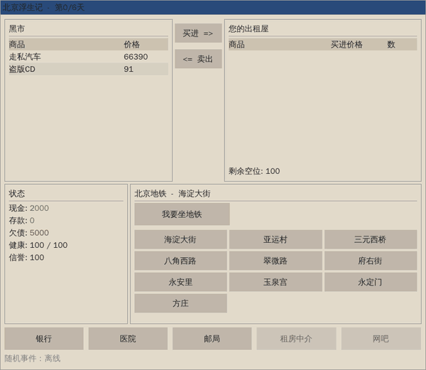
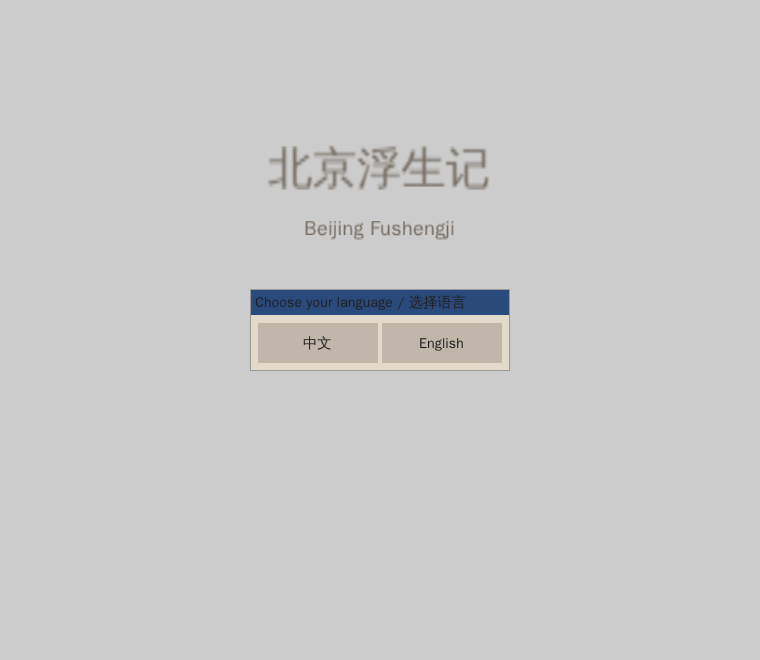
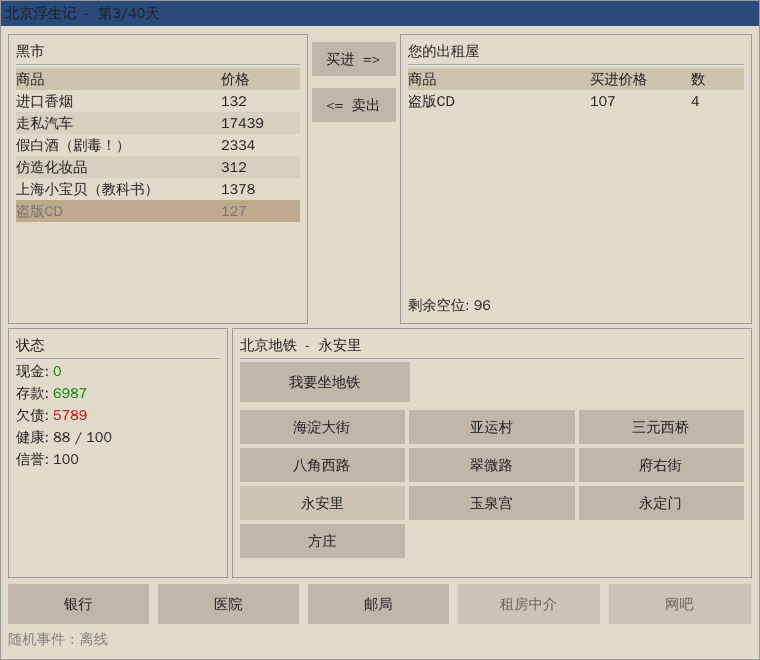
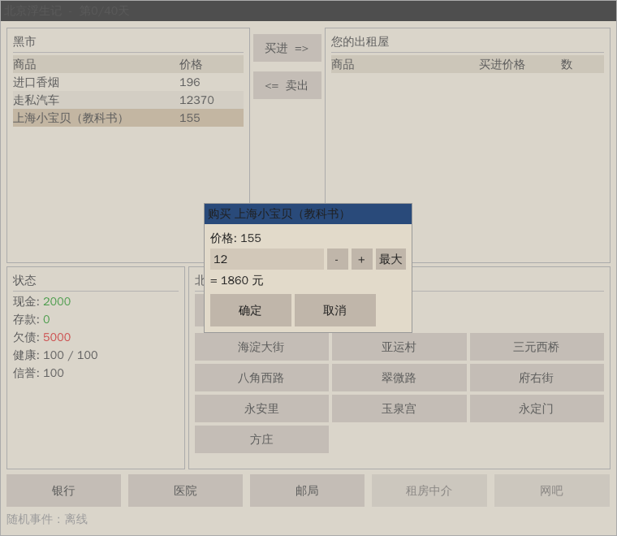
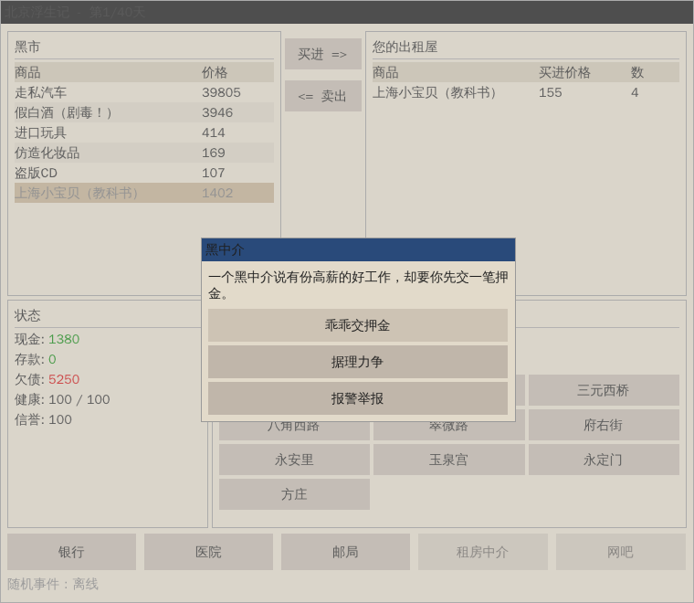
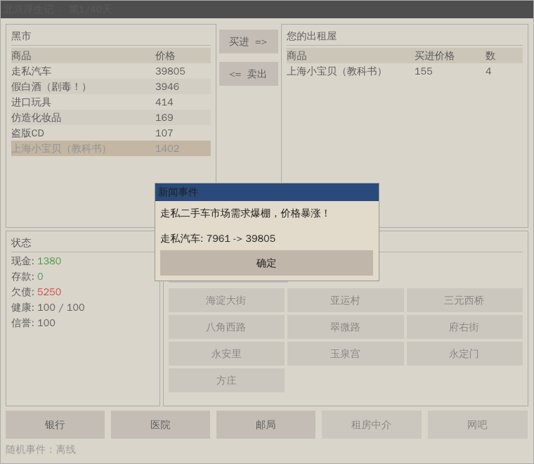
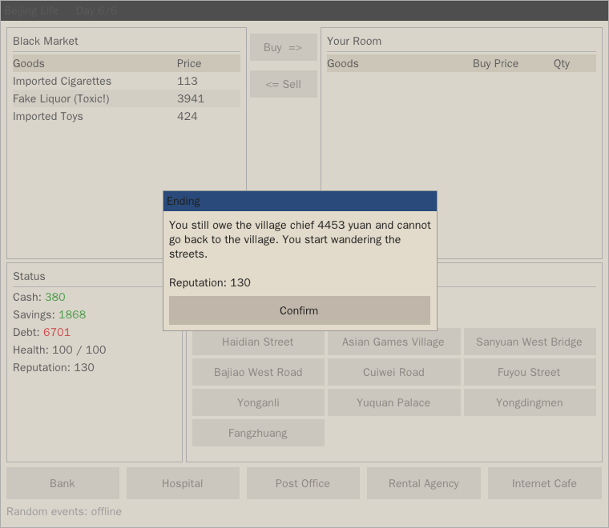
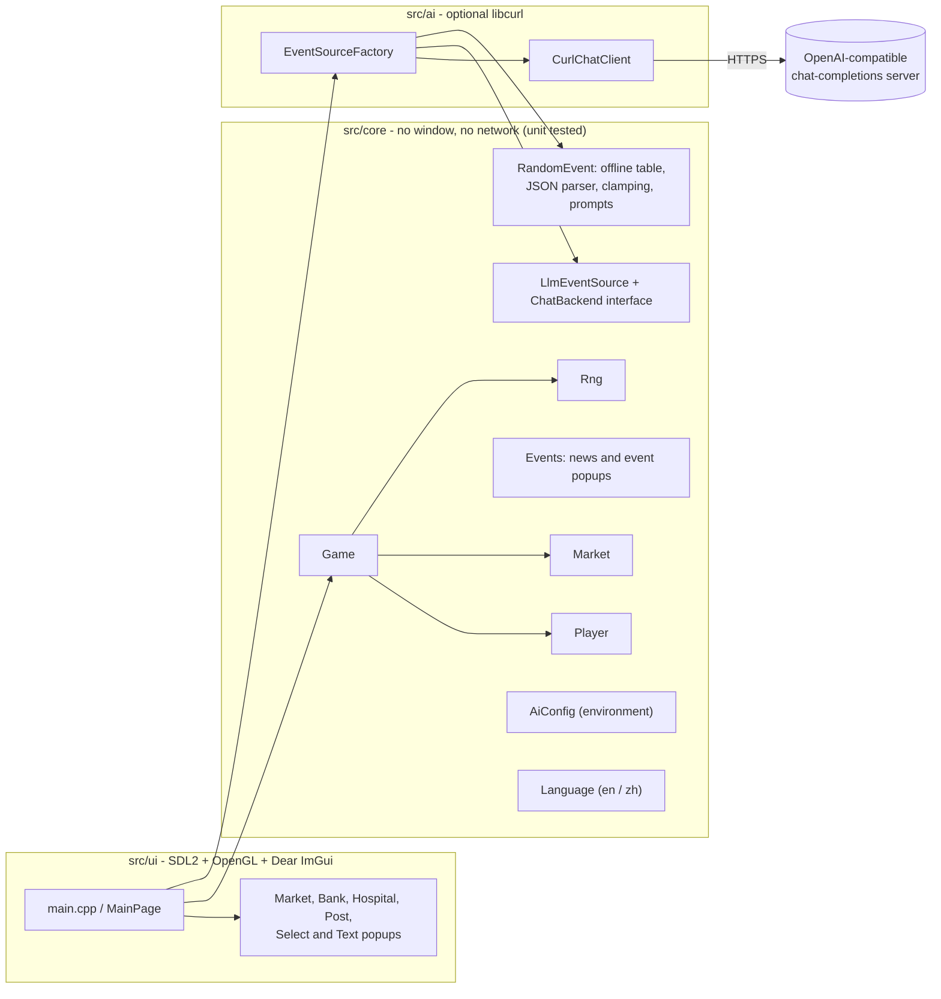

# Beijing Fushengji (北京浮生记)

[](https://github.com/Ctwqk/Beijing_Fushengji/actions/workflows/ci.yml)

**A C++17 remake of the classic trading / life-sim game: buy low, sell high on the Beijing black market and pay off the village chief within 40 days. Bilingual UI (English / 简体中文), SDL2 + OpenGL + Dear ImGui, optional LLM-written random events that fall back to a built-in event table, so it is always playable offline.**

> 《北京浮生记》的 C++17 复刻版：用 40 天在北京黑市倒买倒卖、还清村长的高利贷。支持中文 / English 界面；随机事件可由大模型生成，没有配置服务时自动使用内置事件，完全可以离线游玩。



| Language selector | Chinese UI, mid-game | Buy dialog |
|---|---|---|
|  |  |  |

| Random life event (中文) | News event (中文) | Ending (English) |
|---|---|---|
|  |  |  |

All images were captured from the running game (Xvfb + Mesa software OpenGL inside Docker) by
[`scripts/capture_demo.sh`](scripts/capture_demo.sh); more are in [`docs/screenshots`](docs/screenshots).

## Gameplay

You start in Beijing with 2000 yuan in cash, 5000 yuan of debt to the village chief, full health (100) and a rented
room with 100 slots. After **40 days** you go home and the game settles your accounts.

* **Black market** - seven goods (imported cigarettes, smuggled cars, fake liquor, imported toys, counterfeit
  cosmetics, *Shanghai Baby*, pirated CDs). Every day every good gets a fresh price around its baseline
  (x0.5 .. x1.5) and each good is only on sale with 60 % probability. You can always sell what you hold.
* **News events** - each listed good has an 8 % daily chance of a news item multiplying or dividing its price by 5 for
  that day.
* **Random life events** - on about 30 % of the days something happens (a black-market agent, a permit check, a cold
  snap ...) and you pick one of three options affecting cash, health and reputation. They are
  written by an LLM when one is configured, otherwise they come from a built-in table of 12 bilingual events.
* **Debt and savings** - the debt grows by 5 % per day, money in the **bank** grows by 4 % per day. The **post
  office** repays debt.
* **Hospital** - restores health at 1750 yuan per point. Health 0 ends the game early.
* **Ending** - leftover stock is sold at the last day's prices; `cash + savings - debt` decides whether you can go
  home or end up wandering the streets.

Reputation is tracked, shown and sent to the LLM as context, but nothing is gated on it yet.

### Controls

The game is played with the mouse.

| Action | How |
|---|---|
| Buy | click a row in *Black Market*, press **Buy =>**, choose the quantity (type, `-`/`+`, or **Max**) and confirm |
| Sell | click a row in *Your Room* (or in the market list), press **<= Sell** |
| Next day | click any location button (**Take Subway / Explore City** switches between two sets of names) |
| Bank / Post office / Hospital | buttons along the bottom edge |

*Rental Agency* and *Internet Cafe* are drawn greyed out: they exist in the original game but are not implemented here.

### Command line

```
Beijing_Fushengji [--lang zh|en] [--seed N] [--offline] [--days N] [--font PATH]
```

| Option | Meaning |
|---|---|
| `--lang zh\|en` | skip the language selector |
| `--seed N` | seed every random generator: the same seed gives the same prices, news and offline events |
| `--offline` | never contact an LLM |
| `--days N` | game length, 1–40 days (default 40); shorter runs are useful for demos |
| `--font PATH` | CJK font file (also `FUSHENGJI_FONT`); by default `Font/wqy-zenhei.ttc` next to the executable |

## AI-generated events

Random life events can be written by any OpenAI-compatible chat-completions server. Configuration is purely through
environment variables (nothing is stored in the repository; see [`.env.example`](.env.example)):

| Variable | Default | |
|---|---|---|
| `FUSHENGJI_AI_API_KEY` | - | bearer token; setting it enables the LLM |
| `FUSHENGJI_AI_BASE_URL` | `https://api.openai.com/v1` | base URL (or a full `.../chat/completions` URL). Setting it also enables the LLM, so keyless local servers (Ollama, llama.cpp, LM Studio ...) work |
| `FUSHENGJI_AI_MODEL` | `gpt-4o-mini` | model name |
| `FUSHENGJI_AI_TIMEOUT` | `20` | request timeout in seconds |
| `FUSHENGJI_OFFLINE` | - | `1` forces the built-in events even if a key is set (same as `--offline`) |

```bash
export FUSHENGJI_AI_API_KEY=sk-...                          # OpenAI
# or a local Ollama:
export FUSHENGJI_AI_BASE_URL=http://localhost:11434/v1 FUSHENGJI_AI_MODEL=llama3.1
./build/Beijing_Fushengji
```

The status line shows the configured event source. An AI request can still fall back to the offline table; stderr
records that fallback.

```mermaid
sequenceDiagram
    participant UI as MainPage (UI thread)
    participant G as Game
    participant W as worker thread
    participant F as FallbackEventSource
    participant L as LlmEventSource + CurlChatClient
    participant O as OfflineEventSource
    UI->>G: advanceDay()
    G-->>UI: DayReport (randomEventDue = true)
    UI->>W: EventContext snapshot (day, cash, health, reputation, recent story)
    W->>F: generate(ctx)
    F->>L: generate(ctx)
    L->>L: POST /chat/completions (system + user prompt, 20 s timeout)
    alt valid JSON reply
        L-->>F: RandomEvent (outcomes clamped)
    else HTTP error, timeout, garbage reply
        F->>O: generate(ctx)
        O-->>F: RandomEvent from the built-in table
    end
    F-->>UI: RandomEvent
    UI->>UI: popup with three options; clicking one calls Player::applyDelta
```

How it behaves:

* One request per event, one at a time, issued from a **copy** of the game state. Rendering and window controls stay
  responsive, while travel waits for the event and your choice; advancing quickly cannot skip a pending event.
  The worker never touches live player data.
* The model is asked for a single JSON object (`title`, `description`, three `options` with `text`, `cash`, `health`,
  `reputation`) in the language the player selected. The reply is parsed leniently (markdown fences, chatter around the
  JSON, `<think>` blocks and numbers written as strings are tolerated) and **every number is clamped**
  (cash +-1000, health +-25, reputation +-40), including numbers outside the integer range. These caps limit each
  event's impact; a health penalty can still end a run when the player is already weak.
  The parser requires at least two choices and keeps at most three. Embedded NULs are rejected, as are ImGui's `##`
  label syntax and line breaks in titles/choices; unusable replies fall back to offline events. Valid long choices
  wrap inside their buttons so their full accepted text remains readable.
* Anything that goes wrong (no network, 401/429/5xx, timeout, unusable reply) is logged to stderr and replaced by an
  offline event, so a flaky endpoint never interrupts the game. Logs retain error categories and HTTP status;
  provider response snippets and detailed curl diagnostics are omitted because they can expose credentials or
  private endpoint details.
* What is sent: the day, cash, health, reputation and the character's background plus the last eight event decisions.
  The API key is only ever sent in the `Authorization` header of that request.
* Requests are aborted promptly when the window is closed.

## Architecture



* **`src/core`** (`fsj_core`) holds all rules: `Market` (daily prices, availability, news), `Player` (trading with
  average cost, interest, bank, healing, clamped event outcomes), `Game` (calendar, seeding, ending) and the event
  machinery. It depends on nothing but the standard library and nlohmann/json, so it is tested without a window.
* **`src/ai`** (`fsj_ai`) is the only code that talks to the network. `CurlChatClient` implements the small
  `ChatBackend` interface; without libcurl the library still builds and the factory returns offline events.
* **`src/ui`** draws the state and forwards clicks. Popups are modal ImGui windows with stable ids, queued by
  `TextPopUp`.
* **`third_party/imgui`** is Dear ImGui 1.91.6 (WIP snapshot), trimmed to the core and the SDL2 / OpenGL3 backends.

## Build and run

Needs a C++17 compiler, CMake >= 3.20, SDL2, OpenGL, and optionally libcurl (LLM events). nlohmann/json, GoogleTest and
(if no SDL2 is installed) SDL2 are downloaded by CMake when no system copy is found (`-DFSJ_FETCH_DEPENDENCIES=OFF`
disables that).

### Ubuntu 24.04

```bash
sudo apt-get install -y build-essential cmake ninja-build libsdl2-dev libgl-dev libcurl4-openssl-dev \
                        nlohmann-json3-dev libgtest-dev
cmake -S . -B build -G Ninja
cmake --build build -j4
ctest --test-dir build --output-on-failure     # unit tests + mock-server integration test
./build/Beijing_Fushengji --lang zh --offline
```

### Docker (no packages on the host)

`docker/Dockerfile` contains the whole toolchain plus Xvfb, so you can build, test and even run the game headlessly:

```bash
DOCKER_BUILDKIT=0 docker build --memory=4g --memory-swap=4g -t pu-beijing-dev -f docker/Dockerfile docker
docker run --rm --name pu-beijing-build --memory=4g --memory-swap=4g --cpus=4 \
  --user "$(id -u):$(id -g)" -e HOME=/tmp -v "$PWD":/src -w /src pu-beijing-dev bash -lc \
  'cmake -S . -B build -G Ninja && cmake --build build -j4 && ctest --test-dir build --output-on-failure'

# run the game on a virtual display for 10 seconds (CI also drives the window)
docker run --rm --name pu-beijing-smoke --memory=1g --memory-swap=1g --cpus=2 \
  --user "$(id -u):$(id -g)" -e HOME=/tmp -e LIBGL_ALWAYS_SOFTWARE=1 -v "$PWD":/src -w /src pu-beijing-dev \
  xvfb-run -a timeout --kill-after=3s 10 build/Beijing_Fushengji --lang zh --offline
```

The timed smoke run normally exits with code 124. The classic Docker builder is selected so its memory limits also
apply during dependency installation; runtime containers have separate limits. On a shared host, serialize builds
and leave memory available for other services.

### Windows

CI builds the project with MSVC on `windows-latest` (SDL2 is fetched and built by CMake, libcurl comes from vcpkg):

```powershell
vcpkg install curl:x64-windows
cmake -S . -B build -DCMAKE_TOOLCHAIN_FILE="$env:VCPKG_INSTALLATION_ROOT/scripts/buildsystems/vcpkg.cmake"
cmake --build build --config Release --parallel 4
ctest --test-dir build -C Release --output-on-failure
.\build\Release\Beijing_Fushengji.exe --lang zh --offline
```

Without vcpkg add `-DFSJ_ENABLE_LLM=OFF` for an offline-only build. The Visual Studio project files of the original
version are gone; CMake can generate a Visual Studio solution. The Windows build is checked by CI only (nobody has run
it on a real Windows desktop yet).

### CMake options

| Option | Default | |
|---|---|---|
| `FSJ_BUILD_APP` | ON | build the SDL2/OpenGL game (OFF = core library and tests only, no GUI libraries needed) |
| `FSJ_BUILD_TESTS` | ON | build the unit tests |
| `FSJ_ENABLE_LLM` | ON | build the libcurl client (skipped with a warning when libcurl is missing) |
| `FSJ_FETCH_DEPENDENCIES` | ON | download missing SDL2 / nlohmann_json / GoogleTest |
| `FSJ_WARNINGS_AS_ERRORS` | OFF | `-Werror` / `/WX` (ON in CI) |

`cmake --install build --prefix <dir>` installs the executable and the font (`<dir>/share/beijing-fushengji/Font`).

## Tests

```bash
ctest --test-dir build --output-on-failure
```

81 GoogleTest cases in `tests/` run against `fsj_core` without a window, plus one CTest entry that runs 13 more cases
for the libcurl client against a local mock OpenAI server (`tests/mock_openai_server.py`: auth header, API errors,
HTML gateway errors, timeout, cancellation, fallback). They cover, among others:

* price bands (regression: prices used to random-walk to 0), availability, news multipliers, seeded reproducibility;
* trading rules (negative quantities, cash/space/availability errors, average cost, reputation), interest, bank,
  post office, hospital, clamping of event outcomes;
* game flow: calendar, death, ending settlement, "same seed = same game";
* the LLM layer: prompt building, lenient parsing, clamping, request body, response and error parsing, environment
  configuration, and fallback to offline events.

CTest also checks CLI argument validation without opening a window. Linux CI runs
`python3 tests/test_gui.py build/Beijing_Fushengji build/gui-test` under Xvfb/Mesa to check Chinese rendering,
clean shutdown, and travel locking during a deliberately delayed local AI response. Its screenshots are uploaded
as a CI artifact. It also checks recovery from a NUL-containing event title and actual multiline rendering of long
choices. No real API credentials or paid requests are needed for any test.

See the [verification record](docs/verification.md) for the clean-build commands, results, and limits.

## Project layout

```
CMakeLists.txt        build definition (core, ai, app, tests)
src/core/             game rules and state, events, localisation (no GUI, no network)
src/ai/               libcurl chat client and event-source factory
src/ui/               SDL2 + Dear ImGui front end and popups
tests/                GoogleTest suite, mock OpenAI server and its launcher
third_party/imgui/    vendored Dear ImGui (trimmed)
Font/wqy-zenhei.ttc   WenQuanYi Zen Hei, used for Chinese glyphs
docker/Dockerfile     Linux build/test/demo environment (with Xvfb)
scripts/              screenshot / GIF capture (drives the real game with xdotool)
docs/                 screenshots and demo GIF
.github/workflows/    CI
```

## What changed compared to the original code

The original repository was a Visual Studio prototype (first commit: "v1-buggy"). Besides the new build, CI, tests and
documentation, these bugs were found and fixed (the ones that can be tested without a window have regression tests):

* Prices multiplied the previous price by 0.5..1.5 every day (a random walk with negative drift) and could reach 0,
  which crashed the buy dialog with a division by zero. Prices now vary around a fixed baseline.
* Buying accepted negative quantities (free money); every failed trade reported "not enough money".
* The inventory showed the first purchase price forever instead of the average cost; selling "not on sale" goods threw
  `item already exist` internally.
* Events could push health above 100, after which the hospital paid the player for "negative treatment"; health 0 did
  nothing.
* The final score was computed before the remaining stock was sold, and the sale callbacks used dangling references.
* Two news events per day on average (x5 or /5 prices) were applied through ImGui lambdas holding raw pointers.
* The LLM was called on every move through a `std::async` whose future blocked the UI and raced with player state.
  It also had a hard-coded endpoint and read its key from a file path relative to the working directory.
* The background story promised 5500 yuan at 10 % while the code used 5000 at 5 %; some UI strings were captured before
  the language was chosen and never translated; the font was loaded relative to the current directory.
* Popups opened each other and fought over ImGui's popup stack.

## Design notes and trade-offs

* **Core / UI split.** The rules are plain C++ with injectable seeds and a `ChatBackend` interface, which is what makes
  the 94 GoogleTest cases possible. The UI stays a thin immediate-mode layer.
* **Own RNG helpers.** `std::mt19937` is fully specified by the standard but `std::uniform_*_distribution` is not, so
  `Rng` derives doubles and ranges by hand; a seed is meant to reproduce the same game on GCC, Clang and MSVC (checked
  on GCC only).
* **Fail soft, not hard.** The LLM is an enhancement. Every failure mode degrades to the offline table instead of an
  error dialog, and model output is treated as untrusted input (parsed, validated, clamped).
* **One request, JSON reply.** The original made two chained requests with `|`/`#` delimited text. A single JSON
  request avoids a second network round trip and is easier to validate.
* **Vendored ImGui, fetched everything else.** ImGui is small once trimmed and is built together with the game;
  heavier dependencies come from the system package manager or `FetchContent`.
* **Retained rules, changed economy.** The prototype's opening balances, catalogue prices, 5 % debt interest,
  4 % savings interest, 1750 per health point and 100 slots are retained. Prices now reset around their baselines;
  news probability changed from 50 % to 8 % per listed good, and life events from every move to 30 % of moves
  (except the ending). This is not a balance-identical recreation. A naive bank-everything strategy still loses
  to the debt; the new event frequencies have not been extensively play-tested.

## Known limitations and roadmap

* Rental Agency and Internet Cafe are placeholders; there is no save/load and no high-score list.
* Reputation has no gameplay effect yet.
* Glyphs outside the bundled font's coverage show as `?` in LLM-written text.
* The window layout is fixed for roughly 760x660 pixels and is not DPI aware.
* The macOS code path (GL 3.2 core context) is written but untested. The Windows build is only checked by CI.
* The repository has no `LICENSE` file yet, so no usage rights are granted for the code. The bundled font (WenQuanYi
  Zen Hei) and Dear ImGui (MIT, see `third_party/imgui/LICENSE.txt`) keep their own licences.
